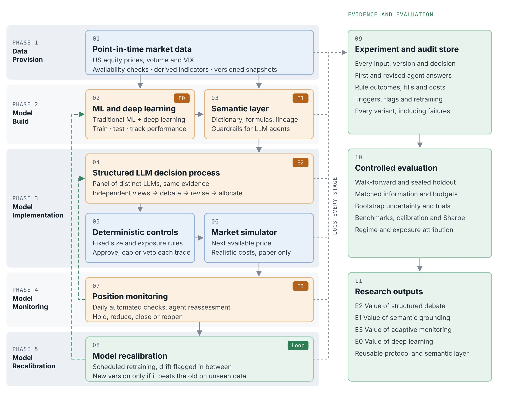

::: {.status-note}
**Current proposal, November 2026.** Proposed doctoral research at Queen's University Belfast. The
direction and scope remain open to supervisory guidance and to the findings of the initial experiments.
:::

Machine learning and deep learning can find predictive patterns in market data, but a forecast on its own
does not decide whether a position should be opened, sized, kept or closed. This research asks whether
several different large language models, given the same calibrated market evidence and made to challenge
one another's conclusions, make better investment decisions than the same models working independently or
strong quantitative methods alone, and whether any improvement is worth its cost. It also tests whether the
same models can manage open positions better than fixed review rules. A finding of no improvement would be
equally informative.

## System architecture

The architecture runs in five phases, from point-in-time market data through model build, LLM decision-making,
monitoring and recalibration, with an evidence and evaluation layer alongside every phase. The interactive
version explains each component: its purpose, how it works, how it is measured, the research it rests on
and what it contributes.

[Open the interactive architecture](architecture.html){.btn .btn-primary}

[{fig-alt="Architecture diagram: eleven components grouped into five phases (data provision, model build, model implementation, model monitoring and model recalibration), with an evidence and evaluation column alongside."}](architecture.html)

## How the proposal evolved

An earlier version of this proposal centred on inferring market regimes. My
[pilot experiments](../quant-lab/index.qmd) found that volatility is forecastable over short horizons but
direction is not, and that regime labels added little beyond volatility. The research therefore moved to
the decision layer: whether language models reasoning over calibrated evidence improve decisions. The
earlier version is [archived](archive.qmd) for reference.

## Core reading

Selected articles behind the main design choices, from journals rated in the ABS Academic Journal Guide
(AJG 2024). Each is linked from the relevant component in the interactive architecture.

| Reference | Design choice it supports | AJG |
|---|---|:--:|
| Whaley (2009), [Understanding the VIX](https://doi.org/10.3905/JPM.2009.35.3.098), *Journal of Portfolio Management* | VIX as a risk measure, not a directional signal | 3 |
| Bollerslev, Tauchen and Zhou (2009), [Expected Stock Returns and Variance Risk Premia](https://doi.org/10.1093/rfs/hhp008), *Review of Financial Studies* | Implied and realised volatility as inputs | 4* |
| Lo, Mamaysky and Wang (2000), [Foundations of Technical Analysis](https://doi.org/10.1111/0022-1082.00265), *Journal of Finance* | Trend and momentum indicators | 4* |
| Sullivan, Timmermann and White (1999), [Data-Snooping, Technical Trading Rule Performance, and the Bootstrap](https://doi.org/10.1111/0022-1082.00163), *Journal of Finance* | A small fixed indicator set; counting every trial | 4* |
| Gu, Kelly and Xiu (2020), [Empirical Asset Pricing via Machine Learning](https://doi.org/10.1093/rfs/hhaa009), *Review of Financial Studies* | Nonlinear machine-learning benchmarks | 4* |
| Fischer and Krauss (2018), [Deep Learning with LSTM Networks for Financial Market Predictions](https://doi.org/10.1016/j.ejor.2017.11.054), *European Journal of Operational Research* | A compact LSTM | 4 |
| Hamilton (1989), [A New Approach to the Economic Analysis of Nonstationary Time Series and the Business Cycle](https://doi.org/10.2307/1912559), *Econometrica* | Regime models | 4* |
| Ang and Bekaert (2002), [International Asset Allocation With Regime Shifts](https://business.columbia.edu/faculty/research/international-asset-allocation-regime-shifts), *Review of Financial Studies* | Why regime shifts matter; adaptive monitoring | 4* |
| Gneiting and Raftery (2007), [Strictly Proper Scoring Rules, Prediction, and Estimation](https://doi.org/10.1198/016214506000001437), *Journal of the American Statistical Association* | Brier score as the primary measure | 4 |
| Diebold and Mariano (1995), [Comparing Predictive Accuracy](https://doi.org/10.1080/07350015.1995.10524599), *Journal of Business & Economic Statistics* | Testing whether one forecast beats another | 4 |
| Gârleanu and Pedersen (2013), [Dynamic Trading with Predictable Returns and Transaction Costs](https://doi.org/10.1111/jofi.12080), *Journal of Finance* | Trading costs and turnover | 4* |

: {.striped}

## Next steps

- A systematic review of AJG-ranked literature for each design choice, including the recent multi-agent
  LLM work, before the originality claim is finalised.
- A pilot study of data coverage, effective sample size, model stability and LLM inference costs, as set
  out in the proposal.
- Strengthening financial econometrics and forecast evaluation alongside the reading above.
